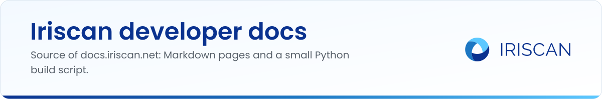

# docs.iriscan.com

Source of the Iriscan developer documentation at [docs.iriscan.com](https://docs.iriscan.com). The pages are written in Markdown, a small Python script turns them into a static site, and GitHub Pages serves the result from the `docs/` folder. If you found a mistake in the docs or want to add a page, this is where to do it.

## What is documented

- [Biometric SDK](https://docs.iriscan.com/sdk): face, liveness and iris recognition on Android, iOS, JVM and React Native, with installation, initialization and code samples.
- [Biometric Converter](https://docs.iriscan.com/converter): fingerprint images to ISO/IEC 19794-2 and ANSI INCITS 378 minutiae templates, as a C library, CLI, REST service and WebAssembly build.
- [Cloud Iris API](https://docs.iriscan.com/cloud-api): REST reference for iris enrollment, 1:N identification and 1:1 verification, generated from the OpenAPI file.
- [Edge service](https://docs.iriscan.com/edge): the local capture and matching service for Iritech iris scanners and webcams.
- [MOSIP and Inji](https://docs.iriscan.com/mosip): how Inji Wallet uses the SDK for offline face match.

## Layout

| Path | What it is |
|---|---|
| `src/pages/*.md` | One file per page: a short YAML header (`title`, `nav`, `desc`) followed by Markdown |
| `src/tenant-api.yaml` | OpenAPI 3 spec of the Cloud Iris API; `{{REFERENCE}}` in `cloud-api.md` is replaced by the rendered endpoints and schemas |
| `src/build.py` | The generator: Markdown to HTML, sidebar, previous/next links, canonical URLs |
| `src/style.css`, `src/favicon.png` | Styling and icon, copied into the site |
| `docs/` | The built site that GitHub Pages serves (`CNAME` and `.nojekyll` live here) |

Page order and sidebar groups are the `ORDER` and `GROUPS` lists at the top of `build.py`.

## Build locally

You need Python 3 and two packages:

```sh
pip install markdown pyyaml
python3 src/build.py docs
```

This rewrites `docs/` (keeping `CNAME` and `.nojekyll`), copies the OpenAPI file to `docs/openapi.yaml` and writes a `404.html` that is a copy of the home page. Open `docs/index.html` in a browser to check the result. Without an argument the script builds into `site/` next to `src/`.

## Contribute

1. Edit or add a page in `src/pages/`. A new page also needs an entry in `ORDER` and in one of the `GROUPS` in `src/build.py`.
2. Run the build and look at the output.
3. Commit both the source and the regenerated `docs/` folder, and open a pull request.

Keep the tone of the existing pages: plain English, short sentences, every acronym explained once, and only facts that match the code in the linked repositories.

## Related repositories

- [biometric-sdk](https://github.com/biometric-technologies/biometric-sdk), [biometric-sdk-react-native](https://github.com/biometric-technologies/biometric-sdk-react-native): the SDK the first section documents.
- [biometric-converter](https://github.com/biometric-technologies/biometric-converter): the converter the second section documents.
- [liveness-detection-model](https://github.com/biometric-technologies/liveness-detection-model): the liveness model referenced from the SDK pages.

## License

License: not yet specified.

## Contact

info@iriscan.net, https://www.iriscan.com
